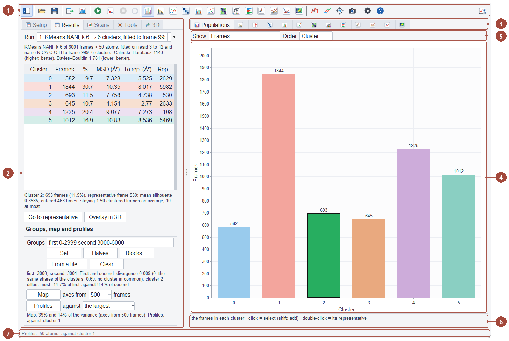
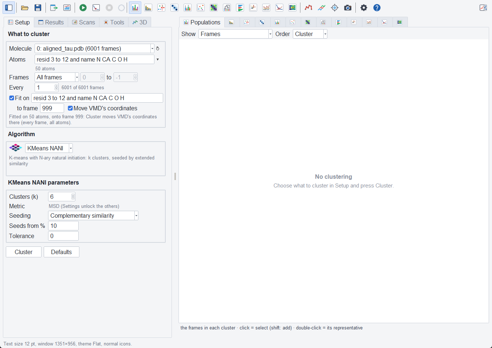

Quick start
===========

Five minutes from a trajectory to its clusters. :doc:`tutorial` goes
through a whole analysis, and says what each step means. The quick-start
guide, a PDF made from the repository's ``quickstart-guide`` folder, goes
through the same example; its script, ``quickstart.tcl``, is the one
below, cell by cell.

In the window
-------------

   (1) The toolbar; (2) the panes: Setup, Results, Scans, Tools, 3D;
   (3) the plots' tabs; (4) the plot; (5) its options; (6) what the
   pointer is on; (7) the status line.

1. Load a trajectory in VMD. It should be superposed, as MDANCE expects.
   If it is not, step 3 fits it.
2. Open **Analysis ▸ VMDance** (VMD 2). In VMD 1.9, it is **Extensions ▸
   Analysis ▸ VMDance**.
3. In **Setup ▸ What to cluster**, choose:

   - the molecule;
   - the atoms (``name CA`` by default). The line under the field says how
     many;
   - the frames, and every n-th;
   - *Fit on* if the frames are not superposed, onto the first clustered
     frame or another (*to frame*), on the values or moving VMD's
     coordinates (*Move VMD's coordinates*). The note under it says
     whether they look superposed.

4. **Setup ▸ Algorithm**: KMeans NANI, with k 6 by default. Press
   |icon-cluster| **Cluster** (Ctrl+R). It runs in the background. The ring in the
   toolbar shows how far it is. With CPP-MDANCE's library before its v2,
   VMD waits until it ends.
5. **Results**: the table of clusters. Click a cluster: it is drawn on top
   in every plot. Double-click it: VMD goes to its representative frame.
6. **The plots**, on the right: Populations, Timeline, Transitions … Hover
   them: the line under the plot says what the pointer is on.
7. |icon-colour| **3D ▸ Colour by cluster**, then play the trajectory: the
   structure takes the colour of the current frame's cluster.
8. Not sure of k? Use |icon-elbow| **Scans ▸ Elbow ▸ Scan**, with
   *Stability* ticked.
   It gives the scores at every k, ringed where they point, and whether the
   clusters depend on the seeding. The readings need not agree
   (:doc:`tutorial`). Double-click a k to make it the clustering
   (:doc:`scans`).
9. Where did each frame come from? Open **Results ▸ Groups**. Press
   **Halves** for the two halves of the run. Or name the replicas or
   conditions by their frames (``first 0-2999 second 3000-6000``), then
   press **Set**. Read the **Make-up** plot, and the line under the box,
   which says how unlike the groups are (:doc:`groups`).
10. |icon-save| **File ▸ Save session** keeps it all. |icon-export|
    **File ▸ Export results** writes the tables and structures.
    |icon-figure| **File ▸ Create figures** writes the plots.

:doc:`window` names every button of the toolbar, with its icon.

   The Setup pane, filled as the script below and :doc:`tutorial` have it.

In a script
-----------

.. code-block:: tcl

   package require vmdance
   # the tau peptide of BitQT's examples (MDANCE's package, pip install mdance, has the two files too)
   set sel "resid 3 to 12 and name N CA C O H"   ;# the atoms MDANCE's tutorial clusters
   set m [mol new aligned_tau.pdb]   ;# set the two paths to your files
   mol addfile aligned_original_tau_6K.dcd waitfor all
   animate delete beg 0 end 0 $m     ;# the PDB's own frame: cluster the DCD's 6001
   set fit [list -fit $sel -fitframe 999 -fitmove 1]   ;# onto frame 999, VMD's coordinates moved
   vmdance elbow -mol $m -sel $sel {*}$fit -kinit CompSim -from 2 -to 12 -stability 1
   vmdance elbow suggest             ;# where the scores point, and the k the seedings agree on
   vmdance elbow load 6              ;# k 6: the clustering
   vmdance clusters
   vmdance export results -prefix tau

Every question the window answers, the command answers too
(:doc:`command`), in text-mode VMD as well (``vmd -dispdev text``).
``vmdance help`` lists its subcommands.
