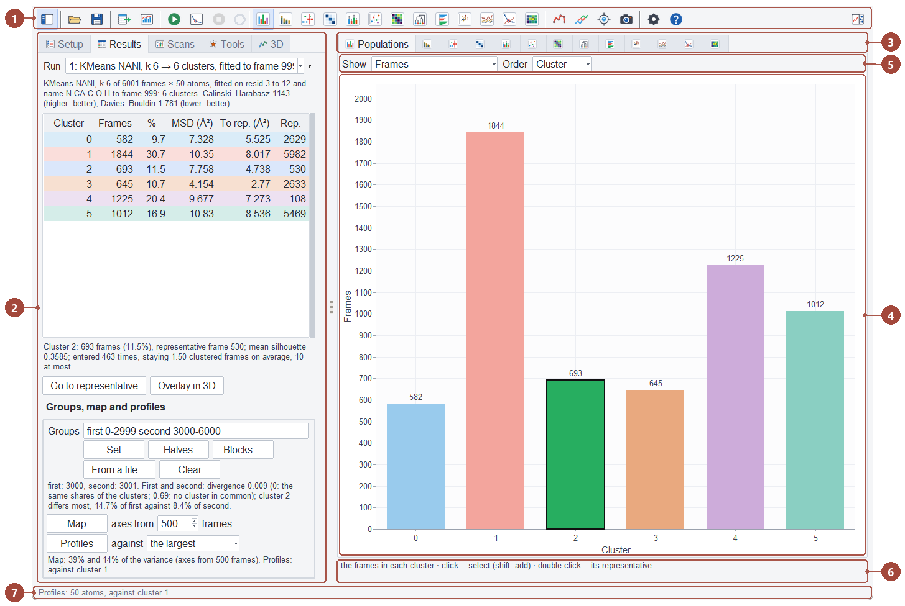
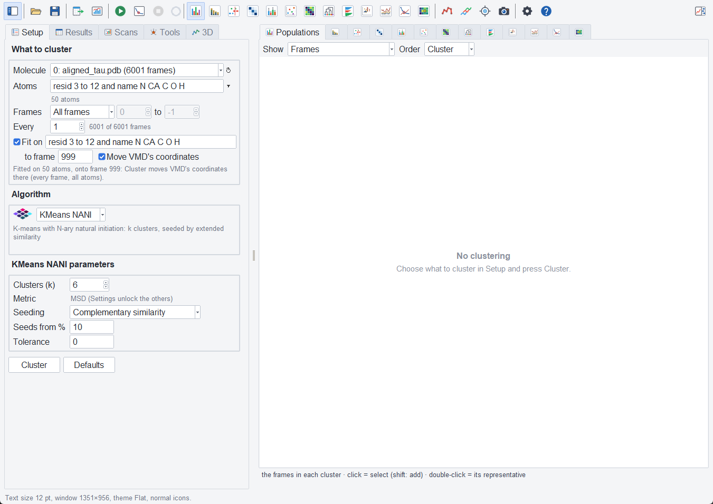
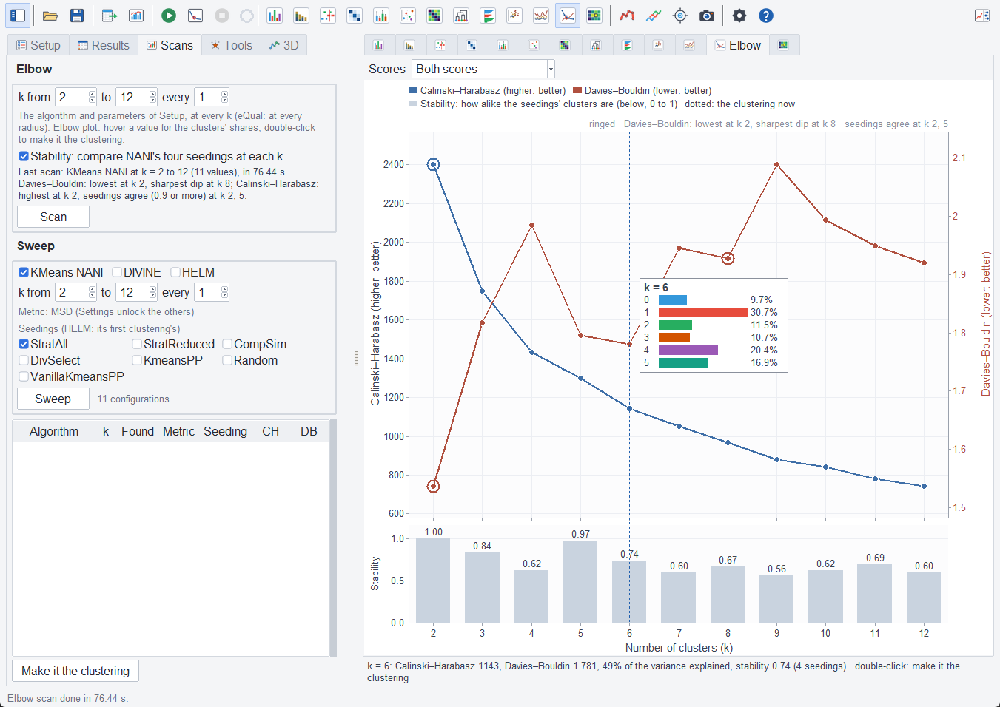
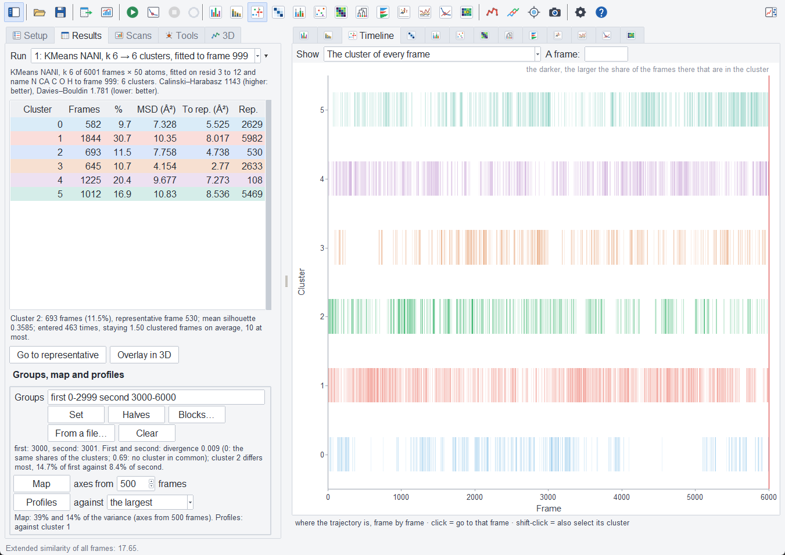
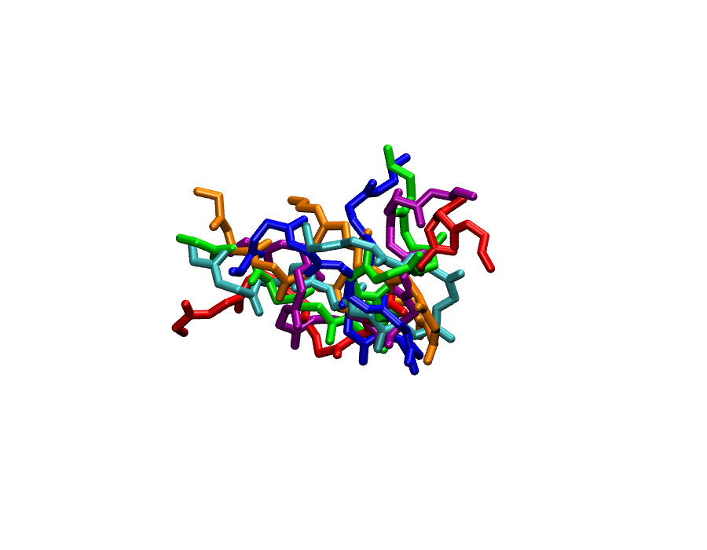
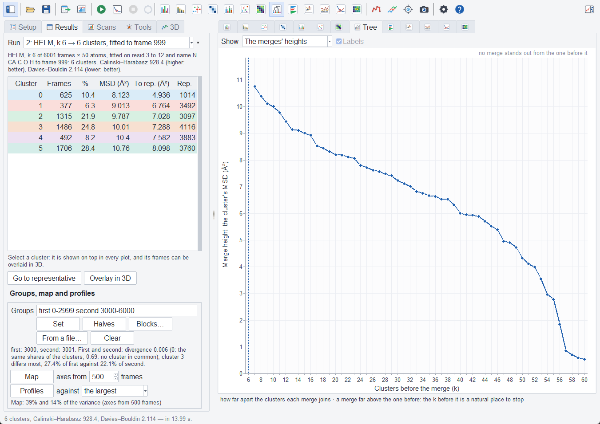
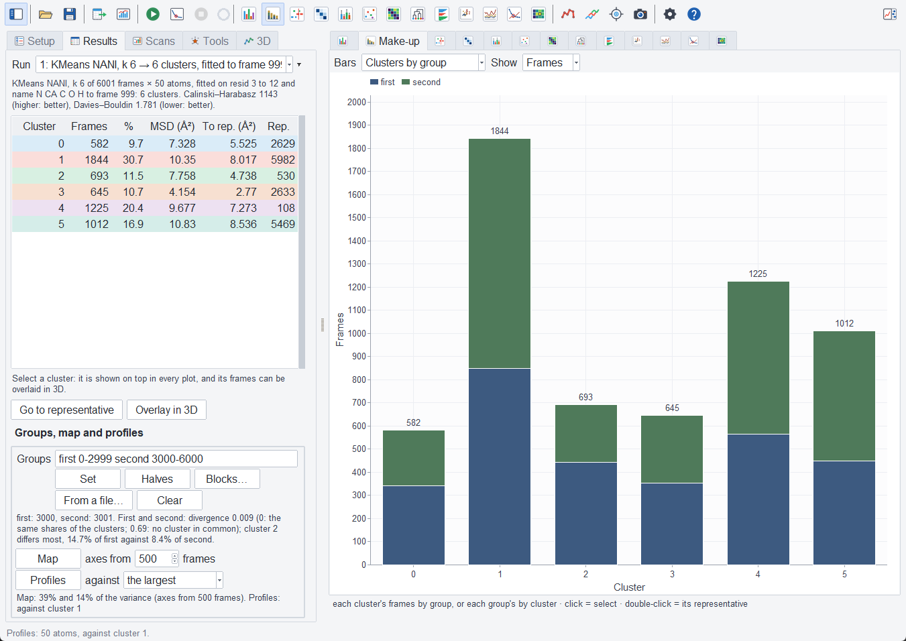

A complete analysis
===================

This tutorial clusters the quick-start guide's example from start to end,
in the window and in a script, with the guide's own choices: the same
atoms, the same fit, the same k. It goes further than the guide, and reads
what each step says.

The trajectory is a tau peptide: 6001 frames of a flexible twelve-residue
peptide, its ends capped. It is the example of BitQT's repository, and
MDANCE's Python package ships the same two files. Every number here was
made with the ``vmdance`` command, and ``docs/tools/tutorial_numbers.tcl``
makes them again. Yours will be the same with the same backend.

.. figure:: _static/diagrams/workflow.svg
   :alt: Load, choose, scan, cluster, explore, keep.
   :width: 100%
   :class: diagram

You need:

- a VMD built with Tcl/Tk 8.6 (VMD 2; tested in 2.1);
- VMDance and CPP-MDANCE (:doc:`install`);
- the data, ``aligned_tau.pdb`` and ``aligned_original_tau_6K.dcd``. They
  are in the ``examples`` folder of `BitQT
  <https://github.com/LQCT/BitQT/tree/master/examples>`_ (``git clone
  https://github.com/LQCT/BitQT.git``), and in the ``mdance/data`` folder
  of MDANCE's package (``pip install mdance``, then ``python -c "import
  mdance, os; print(os.path.dirname(mdance.__file__))"`` says where it
  is).

1. Load the trajectory
----------------------

In VMD, use **File ▸ New Molecule**: load the PDB, then the DCD into the
same molecule.

The PDB brings a frame of its own, which is not part of the trajectory
MDANCE clusters. Delete it, in the **Main** window's frame list or with
the command below. The molecule then has **6001 frames** (6002 with it;
Setup's frame count says which).

.. code-block:: tcl

   set m [mol new aligned_tau.pdb]
   mol addfile aligned_original_tau_6K.dcd waitfor all
   animate delete beg 0 end 0 $m      ;# the PDB's own frame: 6001 left

Open **Analysis ▸ VMDance**. VMD 2's main window has no Extensions menu.
In VMD 1.9, it is **Extensions ▸ Analysis ▸ VMDance**.

   The window: (1) the toolbar; (2) the panes — Setup, Results, Scans,
   Tools, 3D; (3) the plots' tabs; (4) the plot; (5) its options; (6) what
   the pointer is on; (7) the status line. :doc:`window` names every
   button.

2. Choose what to cluster
-------------------------

In |icon-pane-setup| **Setup ▸ What to cluster**, choose:

- the molecule;
- the atoms ``resid 3 to 12 and name N CA C O H``: 50 atoms, the backbone
  of residues 3 to 12 and its amide hydrogens (those MDANCE's own tutorial
  clusters);
- every frame (6001).

The atoms decide what "alike" means. The backbone compares the peptide's
folds. Its side chains are left out, and so are the two flexible ends.

   Setup, filled as this tutorial and the quick-start guide fill it.

**The fit.** Before the box is ticked, the note under *Fit on* reads *Not
fitted. From the first frame: 3.71 Å as they are, 3.3 Å fitted: the frames
look superposed.* The trajectory comes aligned already. A trajectory that
was not is far from its first frame as it is, and near it once fitted: the
note then turns red-brown and says to tick Fit.

The tutorial superposes the frames once more all the same, as the
quick-start guide does: on the atoms it clusters, onto one frame of the
trajectory, frame 999. Tick **Fit on**, with the same atoms; set **to
frame** to 999; and tick **Move VMD's coordinates**. The note then reads
*Fitted on 50 atoms, onto frame 999: Cluster moves VMD's coordinates
there (every frame, all atoms).*

- With *Move VMD's coordinates*, the first Scan or Cluster moves every
  frame of the molecule, all of its atoms, onto frame 999, as an alignment
  in VMD would. Reload the trajectory to undo it. The frames are then
  3.38 Å from the first as they are, 3.30 Å once fitted on it.
- Without it, the fit is computed on the values only, and VMD's
  coordinates stay. The clusters are the same.

The algorithm is KMeans NANI, with **Seeding** set to *Complementary
similarity* (``CompSim``). With it, the seeds come from the densest
frames. The default is *Stratified, all frames*. **Tolerance** stays 0:
k-means runs until no frame changes cluster (``1e-4`` stops where MDANCE's
Python does: :doc:`faq`).

These choices shape every number that follows: the atoms, the
superposition, the frames and the algorithm (:doc:`algorithms`).

3. How many clusters?
---------------------

Open |icon-pane-scans| **Scans ▸ Elbow**. Set k from 2 to 12, tick
*Stability*, and press **Scan**, or |icon-elbow| in the toolbar (a minute
or two). The scan makes the same clustering at every k. It makes it again
from NANI's four seedings that draw no random number, to see whether the
clusters depend on the seeding.

   Calinski–Harabasz (blue), Davies–Bouldin (red) and the stability
   (bars) at every k. The panel gives k 6's clusters' shares.

.. list-table::
   :header-rows: 1
   :widths: 8 24 24 22 22

   * - k
     - Calinski–Harabasz (higher: better)
     - Davies–Bouldin (lower: better)
     - Variance explained
     - Stability (1: the same clusters)
   * - 2
     - 2403
     - 1.54
     - 29%
     - 1.00
   * - 3
     - 1750
     - 1.82
     - 37%
     - 0.84
   * - 4
     - 1435
     - 1.99
     - 42%
     - 0.62
   * - 5
     - 1298
     - 1.80
     - 46%
     - 0.97
   * - 6
     - 1143
     - 1.78
     - 49%
     - 0.74
   * - 7
     - 1051
     - 1.95
     - 51%
     - 0.60
   * - 8
     - 967
     - 1.93
     - 53%
     - 0.67
   * - 9
     - 882
     - 2.09
     - 54%
     - 0.56
   * - 10
     - 843
     - 1.99
     - 56%
     - 0.62
   * - 11
     - 781
     - 1.95
     - 57%
     - 0.69
   * - 12
     - 745
     - 1.92
     - 58%
     - 0.60

The Elbow plot rings the values the scores point to. The Scans box (and
``vmdance elbow suggest``) says them in words: *Davies–Bouldin: lowest
at k 2, sharpest dip at k 8; Calinski–Harabasz: highest at k 2; seedings
agree (0.9 or more) at k 2, 5*. The line above the plot says the same,
shorter.

These are three readings, and they do not agree:

- **The scores are best at k 2.** Davies–Bouldin is lowest there (1.54)
  and Calinski–Harabasz highest. Calinski–Harabasz falls at every k, as it
  does on structures that form no well-separated states. Two clusters are
  the best-separated partition, and a coarse one.
- **Davies–Bouldin dips most sharply at k 8**: 1.93, between 1.95 at k 7
  and 2.09 at k 9. This is MDANCE's second criterion, the largest second
  derivative of Davies–Bouldin at one of its dips. Its first is the lowest
  value. The dip at k 6 is as sharp to the third decimal: 1.78, between
  1.80 at k 5 and 1.95 at k 7. MDANCE's own tutorial goes on with k 6.
- **The seedings agree only at k 2 and 5** (stability 1.00 and 0.97). At
  k 3 it is 0.84, and elsewhere between 0.56 and 0.74. There the clusters
  change with the seeding.

Neither reading is wrong: they answer different questions. k 6 and k 8
are where the score bends. Only at k 2 and 5 are the clusters the same
whatever the seeding.

The variance the clusters explain (*Scores ▸ Variance explained*) settles
nothing here. It rises ever more slowly, from 29% at k 2 to 58% at k 12,
with no sharp bend.

This tutorial goes on with **k 6**, as the quick-start guide and MDANCE's
own tutorial do, for a finer look at the shapes the peptide takes than two
clusters give. Its stability is 0.74: the four seedings do not make quite
the same six clusters. Say so with what you read off them.

For clusters that do not depend on how k-means was started, take k 5
(``vmdance elbow load 5``): it is the finest partition the seedings agree
on.

4. Cluster
----------

Double-click k 6 in the Elbow plot (or ``vmdance elbow load 6``). It is
made the clustering, a run of its own in |icon-pane-results| **Results**.
With *Clusters (k)* at 6 in Setup, |icon-cluster| **Cluster** makes the
same.

   The clusters, and the Timeline: the cluster of every frame.

The clusters hold 582, 1844, 693, 645, 1225 and 1012 frames (10%, 31%,
12%, 11%, 20% and 17%).

The mean silhouette is 0.28. The clusters are loose: their frames are not
much closer to their own cluster than to the next. That is the silhouette
from the clusters' mean structures, which is never below zero for
k-means. From every frame (the Silhouette's option *From*: *Every frame*),
the mean is 0.29, and 573 frames (10%) are below zero. These frames are
nearer another cluster's frames than their own's.

The trajectory stays about two frames in a cluster before it moves on
(**Residence**: 1.5 to 2.0 frames on average, 14 at most). The 6001 frames
are far apart in time, and the peptide changes between any two.

The **Timeline** shows it. With more frames than pixels, its lanes are
shaded by each cluster's share of the frames there. Its view *Each
cluster's share so far* draws the populations settling: every cluster has
been seen by frame 100.

- Click a cluster in the table: it is drawn on top in every plot.
- Double-click it: VMD goes to its representative frame.
- |icon-colour| **Colour by cluster** (the toolbar, or the 3D pane)
  colours the structure by the current frame's cluster as the trajectory
  plays.
- |icon-reps| **Representatives** draws them all at once.

   The representatives (frames 2629, 5982, 530, 2633, 108 and 5469), each
   in its cluster's colour.

5. A second opinion
-------------------

Two other algorithms answer "how many" their own way.

**HELM** merges 60 small clusters two by two, down to 6. In Setup ▸ HELM,
set *Clusters (k)* to 6 and *Start from* to 60, then press **Cluster**.
The Tree plot's *merges' heights* draws how far apart the clusters each
merge joins. A merge far above the one before marks a natural k.

Here the heights climb gently. The last eight merges, from 14 clusters
down to 6, are all between 9.1 and 10.8 Ų. The plot says so: *no merge
stands out from the one before it*. The largest step, 2.2 times the merge
before, is from 56 clusters to 55. It is among the first, finest merges:
it says nothing of a small k, and is not marked.

   HELM's merges' heights: no jump at a small k.

**eQual** finds as many clusters as a radius makes. Choose eQual in Setup,
then open Scans ▸ Elbow: the box then asks for radii. **Suggest** proposes
a range from the frames themselves: 2.4 to 7.9 every 0.61 here, from the
distances between 147 of them.

Scanned at 4 to 12 every 2 (typed in the box, then **Scan**), eQual makes
60 clusters at a radius of 4 Ų, 15 at 6, 7 at 8, 4 at 10 and 2 at 12.
There is no plateau, where several radii would give the same clusters.
The radius is MDANCE's MSD: 8 Ų is an RMSD of 4 Što the seed,
√(2 × 8).

All three say the same: the peptide's conformations form a continuum, not
a few well-separated states. k 6 is a useful partition of it, a look at
the shapes the peptide takes. It is not six states with barriers between
them, and another seeding draws their borders a little otherwise. Say so
when you report it.

6. Compare groups: has the run converged?
-----------------------------------------

First choose the k 6 clustering again in **Results ▸ Run**: HELM's is the
current run now. Then, in **Results ▸ Groups**, press **Halves**, or type
``first 0-2999 second 3000-6000`` and **Set**. The two halves of the
trajectory are now groups. The |icon-tab-makeup| **Make-up** plot shows
each cluster by half.

   Each cluster by the half of the trajectory its frames came from.

Both halves visit all six clusters: no state is missing from either. But
they do not visit them equally. Cluster 2 holds 442 frames of the first
half and 251 of the second.

The line under the Groups box says it in a number: *First and second:
divergence 0.009 (0: the same shares of the clusters; 0.69: no cluster in
common); cluster 2 differs most, 14.7% of first against 8.4% of second.*

The halves are alike, not the same. The populations have not settled to
better than six points of a share. A longer run, or more replicas, would
change them.

Two more plots look at the groups (:doc:`groups`):

- |icon-tab-map| **Map** places every frame on the first two principal
  components (39% and 14% of the variance), coloured by half, with each
  cluster's representative ringed.
- |icon-tab-profiles| **Profiles** says, residue by residue, where the
  clusters differ from the most populated one, cluster 1.

7. Keep it
----------

- |icon-save| **File ▸ Save session** keeps every run, the last elbow scan
  and the last sweep, the groups, the map and the profiles. The last elbow
  scan is eQual's radii here: step 5 replaced the scan by k.
- |icon-export| **File ▸ Export results** writes the tables and the
  structures. Each table has a header saying how it was made.
- |icon-figure| **File ▸ Create figures** writes the plots as PDF, PNG or
  EPS, at the size and text size of a paper's column or a slide
  (:doc:`files`).

The same in a script
--------------------

Every step above is a ``vmdance`` command. The script below runs in VMD's
console or in text-mode VMD (``vmd -dispdev text -e tau.tcl``), but for
its last line: figures need VMD's window (``vmd -e tau.tcl``). It keeps
the work before the second opinion, whose eQual scan would replace the
scan by k. Set the two files' paths to yours: as written, VMD looks for
them in the folder it runs in.

.. code-block:: tcl

   package require vmdance
   set m [mol new aligned_tau.pdb]
   mol addfile aligned_original_tau_6K.dcd waitfor all
   animate delete beg 0 end 0 $m           ;# 6001 frames
   set sel "resid 3 to 12 and name N CA C O H"
   vmdance alignment -mol $m -sel $sel      ;# as_is 3.711 fitted 3.304 … superposed 1
   # the fit: onto frame 999 by those atoms, VMD's coordinates moved there
   set fit [list -fit $sel -fitframe 999 -fitmove 1]
   # how many clusters: the scores and the stability at k 2 to 12
   vmdance elbow -mol $m -sel $sel {*}$fit -kinit CompSim -from 2 -to 12 -stability 1
   vmdance elbow suggest                    ;# db_lowest 2 … db_dip 8 … ch_highest 2 … stable {2 5} …
   vmdance elbow load 6                     ;# k 6: the clustering
   vmdance clusters                         ;# the table
   vmdance silhouette                       ;# mean 0.28 (from the clusters' mean structures)
   vmdance silhouette -kind pairs           ;# mean 0.29 (from every frame)
   # the two halves as groups
   vmdance groups -blocks 2                 ;# first 0-2999, second 3000-6000
   vmdance makeup                           ;# 0 {341 241} 1 {849 995} 2 {442 251} 3 {354 291} 4 {565 660} 5 {449 563}
   vmdance groups compare                   ;# pairs {{first second 0.009046 0.06369 2}} words {…}
   vmdance map
   vmdance profiles
   # keep it
   vmdance session save tau.vmdance
   vmdance export results -prefix tau
   # a second opinion: HELM's merges' heights, eQual's radius
   vmdance -mol $m -sel $sel -algorithm helm -k 6 -initial 60
   dict get [vmdance tree] heights
   vmdance radii -mol $m -sel $sel          ;# … from 2.4 to 7.9 by 0.61
   vmdance elbow -mol $m -sel $sel -algorithm equal -radii {4 6 8 10 12}
   # figures of the k 6 run (VMD's window needed; the elbow is eQual's now)
   vmdance run 1
   vmdance figures figures -plots {populations makeup map} -formats {pdf png} -size column

The quick-start guide's script, ``quickstart-guide/quickstart.tcl``, runs
the same analysis cell by cell.

What to report
--------------

Whoever reads your clustering needs:

- the atoms and the superposition (fitted, on what and onto which frame,
  or not);
- the frames (all, a range, every n-th) and their time apart;
- the algorithm, its parameters and the backend (CPP-MDANCE's version);
- how k was chosen (which reading of the scores, the stability, a second
  algorithm's view);
- the clusters' sizes and silhouette, and which silhouette;
- when there are groups, each cluster's make-up.

The tables the plugin exports carry most of it in their headers.
